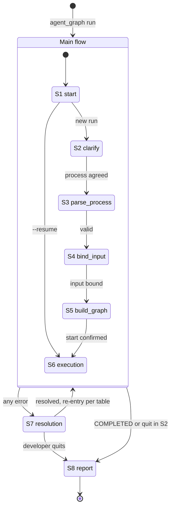
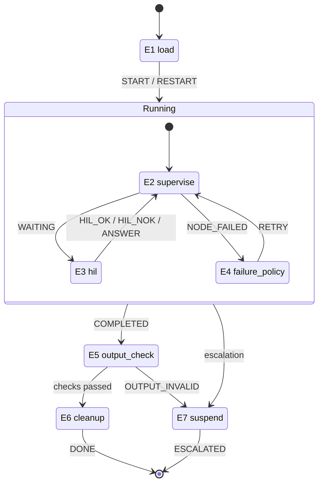
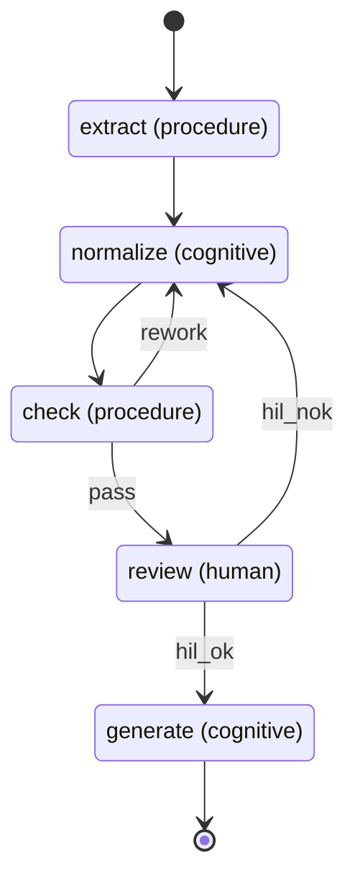

# USS-008 — Run a YAML-defined process as an agent graph

> Status: draft 2. Open questions are listed under "Open items".

## Participants

| Participant | Role |
|---|---|
| Developer | Owns the process: puts one or more process definitions and their input data into the agent workspace, names the process to run in the agent chat, and answers the clarification, review and resolution dialogs in the terminal session |
| Agent container | The gVisor sandbox `agent-<agentID>` from USS-002; workspace mounted at `/workspace`, Claude state at `/home/agent/.claude` |
| Agent runtime | Python program `agent_graph` (LangGraph, `/opt/venv`, USS-003) started inside the container as user `agent` (uid 1001); implements exactly one agent entity |
| Static state machine | LangGraph state machine that is the same for every agent and every process; the **master** |
| S6 execution engine | Sub-state machine of the static state machine; supervises the dynamic state machine |
| Dynamic state machine | LangGraph state machine compiled at run time from the process YAML (steps = nodes, transitions = edges); the **slave** |
| Gateway | Runtime service that owns the terminal; the communication channel for every Claude instance; not a state |
| Context composition | Compose phase of every cognitive node of the dynamic state machine (library function `compose_context`); composes the node's `CLAUDE.md`, skill set and context pack at node start |
| Skill pool | `/workspace/identity/.skills/`: every skill this agent may use, one folder per skill with `SKILL.md` (name, description, tags); the node's compose phase pulls the relevant ones for each cognitive node |
| Snippet pool | `/workspace/identity/.snippet/`: building blocks for `CLAUDE.md`, one markdown file per snippet with front matter; the node's compose phase composes each cognitive node's `CLAUDE.md` from them |
| Claude Code CLI | `claude` in the image (USS-003), called headless by cognitive nodes; uses the agent's own subscription login (no model broker) |
| Execution container | Optional ephemeral container from USS-005 for `procedure` nodes that must not run in the agent sandbox |

## Goal

As a developer, I want to drop one or more YAML process definitions into `/workspace/.process` and input data into `/workspace/.input`, start the agent and name the process in the chat, so that the agent sets `PROCESS_ID`, binds the input for this run, clarifies my intent with me, builds an executable graph from the process, runs it under supervision, gives every LLM step only the `CLAUDE.md`, skills and context that are relevant to that step, talks to me only through the gateway, resolves errors together with me instead of ending the run, supports human review steps, and hands me a validated output in `/workspace/.output`.

## Invocation

```
sudo enter_agent <agentID> -- agent_graph run [--resume <runID>]
```

Run in a shell inside the `agent-host` VM. `enter_agent` (USS-002) execs the command as uid 1001 in `agent-<agentID>`; the terminal it attaches is the agent's only user channel.

| Argument | Required | Meaning |
|---|---|---|
| `--resume <runID>` | no | Resume a suspended or interrupted run from its last checkpoint instead of starting a new one |

The process is not selected on the command line. The developer names it in the chat and S2 clarify agrees it with the developer. S2 sets `PROCESS_ID` (the `id` of the process file). `runID` is `<PROCESS_ID>-<yyyymmdd-hhmmss>`. `PROCESS_ID` and the input binding are stored in `.agent/<runID>/`. S2 creates the run folders `.agent/<runID>/` and `.output/<runID>/` together, each with an exclusive create (fails if the folder exists); an existing folder is never reused for a new run. If either exists, S2 appends `-<n>` to `runID` (`n` = 2 to 9) and tries again; if no free `runID` is left, the run does not start (`NOT_STARTED`, exit 1). Reason: the agent may write `.output/` but not `.agent/` (USS-009 "Write and read zones"), and `agent-tool-guard` treats `.output/<name>/` as a protected run folder only when `.agent/<name>/` exists; so a folder the agent made in advance must never become a run folder. `--resume <runID>` reuses the folders of its own run.

## Workspace layout

| Path (in container) | Owner | Content |
|---|---|---|
| `/workspace/.process/` | Developer (agent: read-only by convention) | One or more process definitions (`*.yml`, format per "Process definition"), each with a unique `id`; the file name is not significant |
| `/workspace/.input/` | Developer (agent: read-only by convention) | Input data for one or more processes; `input.source[*].path` globs are relative to this folder; only the files bound for the run are read |
| `/workspace/.tools/` | Operator/developer, copied from the agent-host tool pool (agent: read-only, USS-009) | Execution tools, one folder per tool `.tools/<tool>/` with `profile.yml`, `image.tar`, `tool.json` (USS-005 "Tool supply"); host side `Workspace-Agents/<agentID>/.tools/<tool>/` |
| `/workspace/identity/.skills/` | Developer (agent: read-only by convention) | Skill pool, one folder per skill with `SKILL.md` |
| `/workspace/identity/.snippet/` | Developer (agent: read-only by convention) | Snippet pool, one `<snippetID>.md` per snippet |
| `/workspace/.output/` | Agent | Final outputs, one folder per run: `.output/<runID>/` (`.output/` created by USS-002; `.output/<runID>/` created by S2 together with `.agent/<runID>/`, never reused). The agent may also store its own outputs in other folders of `.output/` (USS-009) |
| `/workspace/.agent/<runID>/` | Agent | Run state: checkpoint store, run log, resolved graph, status history, `binding.json` (PROCESS_ID, bound input files), `gateway.jsonl` (gateway transcript), `overrides.json` (run overrides from resolution), `resolution/<n>/` (one folder per resolution session: transcript, applied changes, hashes), `archive/work.tar.gz` (archived work products) |
| `/workspace/.agent/<runID>/index.json` | Agent | Skill and snippet index with the hash of every file; built by S3 |
| `/workspace/.agent/<runID>/run_facts.jsonl` | Agent | L3 run facts (developer answers, HIL feedback, resolution summaries); append-only |
| `/workspace/.agent/<runID>/active/` | Agent | Working directory of the running cognitive node: generated `system.md` and `CLAUDE.md`, staged `.claude/skills/`, `context.md`, `context.json`, session ID and transcript; moved to `nodes/<nodeID>/` at node end |
| `/workspace/.agent/<runID>/nodes/<nodeID>/` | Agent | Working directory of one finished cognitive node, filled from `active/` at node end: generated `system.md` and `CLAUDE.md`, staged `.claude/skills/`, `context.md`, manifest `context.json`, session ID and stream-json transcript `transcript.jsonl` |
| `/workspace/.agent/cache/summaries/` | Agent | Summary cache shared by all runs of this agent, keyed by file hash and summary budget |
| `/workspace/.agent/<runID>/work/<nodeID>/` | Agent | Interim work products of one node (declared in `produces:`), input for later nodes; archived, deleted or kept per `runtime.work_products` after the output checks pass |

`identity/` is the agent's identity: it is the same for every process this agent runs. `.process/` and `.input/` change per process.

The workspace stays on the host (`Workspace-Agents/<agentID>`) and survives container removal (USS-006), so a run can be inspected or resumed after recreating the container.

## Architecture: static state machine, execution engine, dynamic state machine

Three parts with separate jobs:

| Part | Defined by | Job |
|---|---|---|
| Static state machine (master) | `agent_graph`, same for every process | Clarifies intent and process, validates process and input, builds the dynamic state machine, hands errors to resolution, reports |
| S6 execution engine | `agent_graph`, a sub-state machine of the static state machine | Runs and supervises the dynamic state machine: human-in-the-loop, retries, timeouts, budgets, output checks, cleanup. It never chooses the next node |
| Dynamic state machine (slave) | The process YAML: `steps` are its nodes, `transitions` its conditional edges | Executes the process: runs one node at a time and follows the edge whose condition holds. Its cognitive nodes compose their own `CLAUDE.md`, skills and context pack at node start |

**Gateway (communication channel).** The gateway is not a state. It is the runtime service that owns the terminal, and it works the same in every state. Every Claude instance that has to talk to the developer goes through it: the S2 clarify dialog, the S7 resolution dialog, the engine's human-in-the-loop and question dialogs, and notices from nodes. The gateway runs one conversation at a time, tags each message with its source (state or node), and logs the transcript to `.agent/<runID>/gateway.jsonl`. No node and no state reads or writes the terminal directly. The diagrams therefore show no gateway transitions.

In the diagrams, an edge leaving a composite state applies to every state inside it; the individual reasons are listed in the tables below each diagram.

### Static state machine



| State | Kind | Responsibility |
|---|---|---|
| S1 `start` | programmatic | Opens the gateway session, checks the preconditions (no other active run, at least one process file). With `--resume <runID>` it loads the checkpoint and re-enters the saved state (S6, or S7 if the run was suspended in resolution) |
| S2 `clarify` | cognitive | Discussion with the developer until intent and process are clear: lists the processes in `.process/` (id, title; files sharing an `id` are listed as not selectable), matches the developer's wording and stated intent against id, title and description, asks back until there is exactly one match the developer confirms. Sets `PROCESS_ID` and creates `runID`. Leaves only on agreement or on the developer's explicit quit |
| S3 `parse_process` | programmatic | Loads the YAML, validates it against `apiVersion`, resolves references, checks steps and transitions (reachability, one edge per outcome, `hil_ok`/`hil_nok` edges on human steps, `reads` available on every path), skills and snippets, and the execution tools in `runtime.profiles` (see "Execution tools"); builds the skill and snippet index (`index.json`) |
| S4 `bind_input` | programmatic + cognitive | Binds `input.source[*]` to files in `/workspace/.input` (asks the developer when a glob matches several candidate sets, asks for `note` sources), checks presence, type and schema, verifies `output-template-ref` and `ruleset` files, writes `binding.json` |
| S5 `build_graph` | programmatic | Compiles the dynamic state machine (`StateGraph`: nodes from `steps`, conditional edges from `transitions`); writes `.agent/<runID>/graph.json`; shows the outline (nodes, edges, human steps, budgets) and waits for the developer to confirm the start |
| S6 `execution` | supervision (sub-state machine) | The execution engine; see below |
| S7 `resolution` | cognitive | Entered on any error of S1–S6. A Claude instance explains the error, proposes fixes and applies those the developer approves (including edits of `.process/` or `.input/` files). Leaves on "resolved" to the re-entry state, or on the developer's explicit quit to S8 |
| S8 `report` | programmatic | Writes the run summary to the terminal and `.output/<runID>/report.md`; sets the exit state and exit code |

**Exit only on request.** No error ends the run. Every error leads to S7; the run ends only when the process completes or the developer explicitly quits (in S2 or S7). Ctrl-C or a container stop suspends the run (`SUSPENDED`); `--resume` continues it. Exception: when S2 finds no free `runID` (see "Invocation"), no run folder exists, so the run ends with `NOT_STARTED`, exit 1, without S7.

**Exit state on quit.** A quit in S2 ends with `INTENT_REJECTED` (exit 3). A quit in S7 ends with the exit state and exit code of the error being resolved (see "Failure cases"); if several errors are open, the one that led to S7 counts. S8 records the open error and the resolution transcript in `report.md`, and the checkpoint stays, so `--resume <runID>` re-enters S7.

**Re-entry after resolution.** S7 returns to the state that failed and starts it again from its beginning. If the resolution changed a prerequisite of an earlier state, it returns to the earliest such state instead, and every state from there runs again. S7 detects changes by comparing hashes taken at S7 entry and exit, not by the Claude instance's own report:

| Changed during resolution | Re-entry state | Then |
|---|---|---|
| Nothing (transient cause fixed, e.g. endpoint reachable again, tool repaired outside) | Failed state | — |
| Run overrides only (budget raised, retry threshold raised, node timeout raised) | Failed state | Overrides stored in `.agent/<runID>/overrides.json` |
| Process choice (developer now wants another process) | S2 | New `runID`; the old run is kept for inspection |
| Process file text, skill pool or snippet pool | S3 | S4, S5 again; S6 restarts at the earliest node whose step, edges or `reads` changed; nodes before it keep their products |
| Input files or binding | S4 | S5 again; S6 restarts at the earliest node that reads a changed input |
| Missing precondition fixed (e.g. process file added) | S1 | — |

A node restarted after resolution starts from its beginning: a new Claude session for a cognitive node, with the resolution summary in its L3 run layer.

### S6 execution engine (sub-state machine)



Escalation from Running: context failure (`NODE_FAILED(context)`, E4), developer stops (E3), failure threshold reached (E4), run budget reached or LLM unavailable (E2).

| Substate | Responsibility |
|---|---|
| E1 `load` | Loads `graph.json`, the checkpoint and the overrides; sends `START` at the entry node, or `RESTART(node)` at the re-entry node after resolution or resume. `RESTART` carries the resolution summary, which is also appended to `run_facts.jsonl` |
| E2 `supervise` | Streams the dynamic state machine and reacts to its status. Runs the timers: each attempt of a node is cancelled (`CANCEL`) when its `timeout` expires and reported as `NODE_FAILED(timeout)`. Counts steps and LLM calls against `budgets` |
| E3 `hil` | Holds the developer dialog through the gateway. For a human step: presents the review brief (`instruction`) and the items in its `reads`, discusses until the developer decides, sends `HIL_OK` or `HIL_NOK(feedback)`. For a cognitive node's question (`WAITING(INPUT)`): asks and sends `ANSWER`. Appends developer answers and HIL feedback to `run_facts.jsonl` |
| E4 `failure_policy` | Counts failed attempts per node (schema mismatch of a product, tool or command failure, timeout). Below the node's `retry` threshold it sends `RETRY` (a cognitive node continues its session with the failure reason as next turn); at the threshold it suspends. `NODE_FAILED(context)` is not retried: it escalates at once |
| E5 `output_check` | After `COMPLETED`: checks `output.target[*]` against its `checks` and `template` |
| E6 `cleanup` | Applies `runtime.work_products` to `.agent/<runID>/work/`: `archive` (default) packs it into `.agent/<runID>/archive/work.tar.gz` and removes the folder, `delete` removes it, `keep` leaves it. Node folders (`nodes/`) with transcripts and manifests are always kept |
| E7 `suspend` | Sends `SUSPEND`, waits for `SUSPENDED`, writes the checkpoint and the reason; leaves S6 with `ESCALATED(reason)` |

### Dynamic state machine (defined by the process)

The process YAML defines the nodes and the transitions; S5 compiles them without adding any. Each node is one step: `procedure` (programmatic), `cognitive` (Claude) or `human` (review or approval). After a node finishes, the dynamic state machine itself follows the edge whose `when` holds (`done`, `outcome == <value>`, `hil_ok`, `hil_nok`). Example compiled from the template in "Process definition":



Unlabelled edges have `when: done`; `pass` and `rework` stand for `outcome == pass` and `outcome == rework`.

Inside every node the dynamic state machine pauses with `interrupt()` wherever the engine must act: when a human step or a question needs the developer (`WAITING`, waits for `HIL_OK`/`HIL_NOK`/`ANSWER`), and after a failed attempt (`NODE_FAILED`, waits for `RETRY` or `SUSPEND`). A node never talks to the developer, never retries itself and never ends the run.

### Engine/dynamic contract

The dynamic state machine is its own LangGraph graph with its own checkpoint thread. The engine drives it by streaming with `Command(resume=…)`.

| Command (engine → dynamic) | Meaning |
|---|---|
| `START` | Begin at `transitions.entry` with the bound input |
| `RESTART(node)` | Start at `node` from its beginning; earlier products are kept |
| `HIL_OK` / `HIL_NOK(feedback)` | Decision on a human step; selects the `hil_ok` or `hil_nok` edge; feedback becomes product `<step-name>_feedback` |
| `ANSWER(payload)` | Answer to a cognitive node's question |
| `RETRY(node)` | New attempt of a failed node |
| `CANCEL(node)` | Stop the current attempt (timeout) |
| `SUSPEND(reason)` | Stop after checkpointing; no further node runs until `RESTART` |

| Status (dynamic → engine) | Meaning |
|---|---|
| `NODE_STARTED(node, context_ref)` / `NODE_DONE(node, outcome, products, summary)` | Progress; `outcome` selects the edge; `context_ref` (cognitive nodes): path to the node's `context.json` |
| `WAITING(node, HIL)` | A human step waits for `HIL_OK` or `HIL_NOK` |
| `WAITING(node, INPUT, question)` | A cognitive node waits for `ANSWER` |
| `NODE_FAILED(node, kind, reason)` | Failed attempt; `kind` is `schema`, `tool`, `timeout` or `context` |
| `COMPLETED(output_ref)` | `END` reached; output staged |
| `SUSPENDED` | Acknowledges `SUSPEND` |

A step's `success`, `failure` and `warning` PRINTs are reported as `NODE_DONE`, `NODE_FAILED` and a notice; the gateway prints them.

## Skills and CLAUDE.md management

Goal: at every cognitive step Claude sees only the instructions and skills that matter for that step. Nothing is loaded "just in case".

### Composition at node start

Every cognitive node of the dynamic state machine composes its own working set when it starts, before its Claude session opens. It runs three internal phases: **compose** (pull the declared skills, build `system.md` (L0+L1), `CLAUDE.md` (L2+L3) and `context.md`, write `context.json`), **session** (`claude -p` turns), **check** (products against their schemas). The composer is one library function, `compose_context`, compiled by S5 into every cognitive node; it is pure: the same inputs give the same bytes.

Inputs of the compose phase:

| Input | Source |
|---|---|
| Step definition (`snippets`, `skills`, `exclude_skills`, `max_skills`, `tools`, `budget`, `reads`, `instruction`) | `graph.json` |
| Skill and snippet index | Built once by S3 from the pools; stored in `.agent/<runID>/index.json` with the hash of every file |
| Products and inputs the step reads | `work/`, `binding.json` |
| Run facts for L3 (developer answers, HIL feedback, resolution summaries) | `.agent/<runID>/run_facts.jsonl`, appended by the engine and S7 |
| Summary cache | `.agent/cache/summaries/`, keyed by file hash and summary budget, shared by all nodes and runs of this agent |

The engine does not take part: there is no `NODE_READY`/`CONTEXT` exchange. A compose failure (mandatory context over budget; missing skills and snippets are already rejected by S3) is reported as `NODE_FAILED(context)`; it is not retryable and escalates at once.

### Byte-stable composition for prompt caching

Each node session sends its prompt prefix again on every turn. The prompt cache reads only at positions where an earlier request set a cache breakpoint, and Claude Code sets the breakpoints itself. The system prompt ends at one. Claude Code delivers `CLAUDE.md` as one block inside the first user message, so layers inside `CLAUDE.md` are not cacheable separately across nodes: an identical L0+L1 head in `CLAUDE.md` gives no cross-node cache hit. Therefore the compose phase writes L0+L1 into `system.md`, and the node passes it with `--append-system-prompt-file`. The prompt, in order:

1. Tool definitions.
2. Claude Code default system prompt.
3. `system.md` (L0+L1). End of the shared prefix; cache breakpoint.
4. First user message: moved dynamic sections, `CLAUDE.md` (L2+L3), skill list, `context.md`.
5. Turns.

`system.md` is byte-identical for all cognitive nodes of a run. Parts 1–3 are the shared prefix across nodes; call its token size P. The composer writes all layers byte-identically so the cache can be reused.

**Canonical order.** Stable content first, variable content last:

| Position | Content | Order inside | Stable across | Delivered in |
|---|---|---|---|---|
| 1 | L0 agent snippets | Sorted by snippet `id` | All nodes, runs and processes of this agent | `system.md` |
| 2 | L1 process snippets | Declaration order in `runtime.snippets` | All nodes of the process | `system.md` |
| 3 | L2 step snippets, then the generated step contract | Declaration order, then `auto: true` snippets sorted by `id`; contract from a fixed template with fixed field order | One node (all its turns and retries) | `CLAUDE.md` |
| 4 | L3 run facts | Append-only, in the order they occurred | Grows; a restarted node sees the earlier facts unchanged | `CLAUDE.md` |

**Normalization rules.**
- Snippet and skill files are copied verbatim (front matter stripped for snippets only); nothing is rewritten or re-wrapped.
- UTF-8, LF line endings, no trailing whitespace, one blank line between snippets, one final newline.
- No timestamps, run IDs, absolute paths or counters in `system.md` or in L2 of `CLAUDE.md`; paths are relative to the node's working directory.
- Structured data (step contract, `context.json`) is serialized with sorted keys and fixed number formatting.
- Staged skills: folder names sorted; `SKILL.md` and its files byte-identical to the pool.
- `context.md`: fixed section order (goal and output schema, items cited in `reads` in their listed order, handoff notes, run facts); stable items before variable ones.
- The pool hashes in `index.json` are fixed for the run; a pool change happens only through S7 and re-enters S3, which rebuilds the index.

**Check.** `context.json` records the SHA-256 of `system.md`, of `CLAUDE.md` and of the launch command (flags and model, without the turn prompt, `--resume` and `--allowedTools`). All cognitive nodes of a run have the same `system.md` and launch hashes; composing a node again with unchanged inputs gives the same `CLAUDE.md` hash. Equal hashes prove equal bytes, not cache hits. Hits are verified from the token usage, see "Verifying prompt caching".

**Node launch.** Every cognitive node starts its session like this:

```bash
claude -p "<turn>" --output-format stream-json --verbose \
  --model <run model> --effort <run effort> \
  --tools <runtime.tools> --allowedTools <step tools> \
  --setting-sources project --strict-mcp-config --mcp-config <run mcp.json> \
  --exclude-dynamic-system-prompt-sections \
  --append-system-prompt-file system.md \
  [--resume <sessionID>]
```

Only the turn prompt, `--allowedTools` and `--resume` differ between nodes. Model and effort are set per run; a process cannot set them per step.

**What else must be identical.** The prompt cache matches on the exact prefix, and Claude Code puts more than `system.md` in front of the conversation. Cross-node cache hits need all of these to be equal for every cognitive node:

| Prefix part | Risk | Measure |
|---|---|---|
| Tool definitions | A different set per node changes the very first part of the prefix | `--tools` = `runtime.tools` for every node; a step narrows by permission with `--allowedTools`, never with `--tools` |
| Environment block (cwd, env info, memory paths, git status) | Differs per node directory and per git state | `--exclude-dynamic-system-prompt-sections` moves it after the shared prefix; the fixed `active/` directory is kept for simple paths, no longer needed for caching; whether the date stays in the system prompt is to be verified |
| Settings, MCP servers, plugins | User settings can add tools, hooks or skills | `--setting-sources project`, `--strict-mcp-config` with one MCP config per run |
| Staged skill list | Differs per node by design | Sits in the messages after the shared prefix (seen in interactive sessions; to be confirmed for `-p`) |
| Model, effort, thinking, CLI version | Any difference changes or invalidates the prefix | Pinned per run; CLI version pinned in the image |
| Cache lifetime | The cache expires one hour after its last use (Claude Code requests the 1-hour TTL; the API default is 5 minutes) | Expected loss only when a human step or a resolution takes longer than an hour; no keep-alive. The TTL is confirmed from `ephemeral_1h_input_tokens` |

Within a node, every turn, `ANSWER` and `RETRY` reuses the whole previous prompt. Across nodes the gain is P per node (one cache write saved on the first turn). The within-node reuse is the larger part.

### Verifying prompt caching

`context.json` records the usage of every turn from the stream-json `assistant` events (`message.usage`): `input_tokens`, `cache_creation_input_tokens`, `cache_read_input_tokens`, `cache_creation.ephemeral_1h_input_tokens` and `cache_creation.ephemeral_5m_input_tokens`.

| Check | Expected |
|---|---|
| Baseline P | Two probe runs with the node flags and different `CLAUDE.md`: the cache read of the second run is P |
| Node turn 2 and later | Cache read about the whole previous turn's prompt; cache creation small |
| First turn of each later node | Cache read about P_run, the same for every node |
| Same node restarted with unchanged inputs | Cache read about the whole first-turn prompt |
| TTL | `ephemeral_1h` > 0 and `ephemeral_5m` = 0; after more than 60 minutes idle the cache read is 0 |

**Probe.** `design/tools/cache_probe.py` varies one factor at a time (working directory with and without the exclude flag, `--tools` vs `--allowedTools`, staged skills, git repo or not, `system.md` content, effort) and prints the first-turn cache read of each pair. It makes real calls that count against the subscription usage. Run it against the CLI version pinned in the image and record the results under "Open items".

**Localizing a break.** Point `ANTHROPIC_BASE_URL` at a local logging proxy, strip the auth headers from the log, and diff two request bodies after removing `cache_control`. The first differing byte is where caching ends. The server-side cache diagnostics beta is not available with the subscription login (`--betas` works for API-key users only).

**Standing check.** P_run is the first-turn cache read of the second cognitive node of the run. A later node whose first-turn cache read is below 90 % of P_run gives a `CACHE_PREFIX_DRIFT` notice through the gateway and a line in `report.md`. It is not an error and does not lead to S7.

### Node isolation, snippets and skills

**Isolation.** Every cognitive node runs in its own `claude -p --output-format stream-json` session, started fresh at node entry. During its session the node's working directory is `.agent/<runID>/active/`; at node end it is moved to `nodes/<nodeID>/` (see "Workspace layout"). The node's compose phase writes `system.md`, `CLAUDE.md` and the `.claude/skills/` there. User-level `~/.claude/CLAUDE.md` is empty (L0 and L1 reach a node only through `system.md`); `~/.claude/skills/` is empty: all skills come from the skill pool and are staged per node, so every skill can be excluded from a node. No `CLAUDE.md` is placed in `/workspace` or `/workspace/.agent` by the runtime, so a parent folder cannot add instructions to a node by accident.

**CLAUDE.md from the snippet pool.** The node's compose phase builds its `system.md` (L0, L1) and its `CLAUDE.md` (L2, L3) only from snippets of the pool plus a generated step contract and run facts. A snippet is a markdown file with front matter:

```markdown
---
id: summary-rules
layer: step            # agent | process | step
tags: [writing, summary]
auto: false            # true: may be picked by tag match without being declared
---
- Keep each section under 150 words.
- Cite the source file for every number.
```

The composer builds four layers, each with a size cap. When the total is over the cap, optional (auto-picked) snippets are dropped first, then the lowest layer is shortened:

| Layer | Source | Content | Delivered in |
|---|---|---|---|
| L0 agent | All snippets with `layer: agent` | Identity, hard rules (workspace boundary, no direct user I/O, output schema required) | `system.md` (appended system prompt) |
| L1 process | Snippets listed in the process `runtime.snippets` | Process goal, domain rules, conventions | `system.md` (appended system prompt) |
| L2 step | Snippets listed in the step `snippets:`, plus `auto: true` step snippets whose tags match the node goal; plus the generated step contract (goal, input and output contract, budget) | What this step must do and return | `CLAUDE.md` |
| L3 run | Generated from run state | Developer answers, HIL feedback, resolution summaries | `CLAUDE.md` |

The order of snippets inside a layer is the order of declaration; auto-picked snippets come last. `context.json` lists every snippet ID used, per layer.

**Skill selection.** Skills are pulled from the skill pool `/workspace/identity/.skills/`. In the compose phase of each cognitive node:
1. takes the skills the process (`runtime.skills`) and the step (`skills:`) declare: always staged; a missing one is `PROCESS_INVALID` at S3;
2. removes the skills the step excludes (`exclude_skills:`): an excluded skill is out of scope for this node, is never staged and is not ranked; `exclude_skills` may remove a process-declared skill but not one the same step declares; excluding a skill the same step declares, or a name not in the skill pool, is `PROCESS_INVALID` at S3;
3. ranks the other pool skills by match of their name, description and tags with the node goal;
4. stages at most `max_skills` (step, else `runtime.max_skills`, else default 3) into the node's `.claude/skills/`; the rest are not visible to the node.

**Exclusion.** `exclude_skills` is the one manual control: it removes skills that are fully out of scope at a node (for example an extraction skill at a writing step), even when ranking would pick them. There is no exclusion at process level; a skill this agent should never use is removed from the pool.

Since Claude loads a skill body only when it uses the skill, staging costs only the description; the cap keeps the description list short and the choice clear.

**Read-only sources.** The runtime never edits `.process/`, `.input/`, `.tools/` or `identity/`, except in S7 resolution, and only with the developer's approval of each change. Each change is recorded in `.agent/<runID>/resolution/<n>/`.

## Execution tools

Execution tools (USS-005 ephemeral execution: profile plus image) are supplied by the operator by hand from a tool pool on agent-host, the same way process definitions are copied into `.process/`. In the workspace each tool is a folder `/workspace/.tools/<tool>/` with `profile.yml`, `image.tar` and `tool.json`; host side `Workspace-Agents/<agentID>/.tools/<tool>/`. The agent only reads them (USS-009).

A process declares the profiles it may use in `runtime.profiles`: for `procedure` steps (an isolated step runs through `run_ephemeral_container`, USS-005, and names its profile in `profile:`) and for the `exec_*` tools of cognitive steps. Every step `profile:` must be listed in `runtime.profiles`.

**Static check (S3).** Before any node runs, for every profile in `runtime.profiles`:
1. the tool folder exists in `/workspace/.tools/`;
2. `run_ephemeral_container list --json` reports the profile valid (schema and ceilings);
3. its `image.tar` is present and its digest matches the profile.

A missing or invalid tool is a pre-run error handled like the other validation errors (`PROCESS_INVALID`, S7 resolution with the developer), never a run-time failure. The check does not load images; loading is lazy at first use. Where the tool pool lives on agent-host and how tool provenance is checked are open (see "Open items").

## Context management

Goal: every LLM call gets the smallest context that holds what the step needs: the full conversation of its own node, and from other nodes only their work products and handoff notes.

- **One session per node.** A cognitive node starts one session at node entry and keeps it until `NODE_DONE`: every turn, every developer answer to its `WAITING(INPUT)` and every retry (`RETRY`) continue that session (`claude -p --resume <sessionID>`), so the node keeps its full chat history. A retry gets the failure reason as its next turn. A node restarted after resolution (`RESTART`) gets a new session with the resolution summary in L3. The session ID is stored in the run checkpoint, so `--resume <runID>` continues the same session. No conversation history is carried from node to node; what crosses a node boundary is chosen by the node's compose phase.
- **State holds references, not payloads.** The graph state stores file paths, short summaries and structured results. Large data stays in files.
- **Handoff note.** Every cognitive node returns, besides its output, a short handoff note (what was done, decisions, open points) used as the summary of its result for later nodes.
- **Context pack.** The node's compose phase writes `context.md`, filled in this order until the node's token budget (step `budget`) is used (stable items before variable ones, see "Byte-stable composition for prompt caching"):
  1. node goal and output schema;
  2. what the step cites in `reads:` (inputs, templates, rulesets and earlier products, cited by name, in their listed order; inline when small, else path plus summary);
  3. handoff notes of the direct upstream nodes;
  4. run facts that apply to the node (developer answers, HIL feedback, resolution summaries).

  Anything left out is listed by path so Claude can `Read` it on demand ("pointer over payload").
- **Summarize, don't truncate.** An item over its share of the budget is replaced by a summary (cognitive, cached per file hash) or, for structured data, by a schema and a sample.
- **Long nodes.** When a node session nears the node budget, Claude Code compacts it inside the same session; the history is not dropped. Each compaction is recorded in `context.json`.
- **Manifest.** `context.json` per node records the `CLAUDE.md` layers, staged skills, excluded skills, consumed work products, context items with token counts, what was left out and why, and the actual token usage. A run can be reproduced and its context choices checked.

## Interim work products

Where a step can hand on a concrete result, it does so as a file, not only through its handoff note. This makes the next step's input explicit, checkable and small.

- **Declare.** A node lists its products in `produces:` as entries `{name, file, schema}` (`file` defaults to `<name>.json`). A later step cites a product by its name in `reads:`.
- **Write.** Products are written to `.agent/<runID>/work/<nodeID>/`. For a cognitive node the path is given in its step contract (L2); for a `procedure` step it is passed with the `{work}` placeholder.
- **Check.** Before `NODE_DONE` the runtime checks that every declared product exists and matches its schema; otherwise the node reports `NODE_FAILED(schema)` and the failure goes to E4 failure_policy (retry below the threshold, else suspend and escalate to S7).
- **Consume.** The node's compose phase puts the products a step cites in `reads:` into its context pack (inline when small, else path plus summary). A node sees only the products it reads, not the whole `work/` folder.
- **Validate the graph.** S3 checks that every product in `reads` exists on every path into the reader; otherwise `PROCESS_INVALID`. Optional reads (entry ending in `?`) are excepted.
- **Cleanup.** After the output checks pass, E6 applies `runtime.work_products` to `work/`: `archive` (default), `delete` or `keep`.
- **Resume.** Products stay in `work/` until cleanup; a resume or a `RESTART` after resolution keeps the products of the nodes before the restart node and does not repeat them.
- **Final output.** Products named `output.target[<Name>]` are written to `.output/<runID>/` and checked by E5.
- **Where not feasible.** A node without `produces:` hands on only its handoff note.

## Process definition

The format is the template `tmpl_proc_v3.yml` from a private template repository. It is synthesized from `tmpl_proc_v2.yml` (action-verb runbook) and the earlier sketch of this story. A v3 process is the definition of the dynamic state machine: steps are its nodes, `transitions` its edges. The copy below is kept in sync with that file; the file is the source of truth.

| Earlier sketch | v3 |
|---|---|
| `apiVersion` | `apiVersion` (`agent-graph/v1`) |
| `name` | `id` (becomes `PROCESS_ID`) + `title` |
| `goal` | `description` |
| `inputs` | `input.source` (`path` relative to `.input`, or `note`) |
| `outputs` (checks) | `output.target` (`template`, `checks`) |
| `snippets`, `skills`, `max_skills`, `budgets` | `runtime.*` |
| `nodes` | `steps` |
| `kind` (`exec` → `procedure`) | `type` (`procedure`, `cognitive`, `human`); `checkpoint` with approval → `human`; `gate` → step with `outcomes` + `SET_OUTCOME`; `communicate` and `memory` dropped |
| `prompt` | `instruction` (action-verb pseudocode) |
| `consumes` + `context.reads` | `reads` |
| `tools` (per node) | `runtime.tools` (shared tool set) + step `tools` (permission subset) |
| `context.budget` | `budget` |
| `output_schema` | `produces[].schema` |
| `edges`, `entry`, `finish` | `transitions.entry` + `transitions.edges` (`from`, `to` or `END`, `when`) |
| `retry` | per-step `retry` / `runtime.retry`: failure threshold before the engine escalates |
| (new) | `runtime.timeout` (per-step default), `runtime.work_products` (`archive` \| `delete` \| `keep`) |
| (new) | `runtime.profiles` (optional, execution profiles the process may use), step `profile` (procedure steps; must be listed in `runtime.profiles`); exact schema change TBD (process_v1 schema) |

```yaml
# ==============================================================================
# IMPERATIVE: open only the files this process's own input[*] entries resolve
# to for the current invocation, or files the invoking prompt names
# explicitly. Bound for the entire execution!
# ==============================================================================

# ==============================================================================
# AGENT-GRAPH PROCESS TEMPLATE (v3)
# Synthesis of tmpl_proc_v2.yml (action-verb runbook: header + steps in one
# file) and the USS-008 process definition (executable by agent_graph).
# A v3 process IS the definition of the dynamic state machine: every step is
# one node, every transitions[] entry one conditional edge. The static state
# machine selects, parses, binds and compiles it; its S6 execution engine
# supervises it (human-in-the-loop, retries, timeouts, budgets, cleanup) but
# never decides which node comes next. A cognitive node composes its own
# CLAUDE.md, skills and context pack at node start, byte-stable for prompt
# caching (USS-008 "Skills and CLAUDE.md management"). A v2 process becomes a v3 process by
# adding apiVersion, runtime, transitions and, per step, the fields marked
# [v3]. Every v2 field keeps its name and meaning.
#
# Placement and selection:
#   - Any file name under /workspace/.process/; several processes may sit side
#     by side, as may input data for several processes under /workspace/.input/.
#   - The developer names the process in the agent chat. S2 (clarify) matches
#     the wording against id, title and description of every process file and
#     sets PROCESS_ID = id. The file name is not significant.
#   - S4 (bind_input) binds input.source[*] to concrete files of
#     /workspace/.input/ for this run only; nothing outside the binding is
#     opened (IMPERATIVE above).
#
# Header fields:
#   apiVersion  - [v3] process schema version, checked by S3 (agent-graph/v1)
#   id          - short process id (e.g. proc_m0); becomes PROCESS_ID; unique
#                 across /workspace/.process/
#   title       - human-readable process name, the name the developer uses in
#                 the chat
#   description - one paragraph: what artifact(s) this process derives or
#                 updates, from what inputs, and what it is a prerequisite
#                 for, if anything; S2 checks the developer's intent against it
#
# input:
#   source              - records/artifacts consumed as facts for this run;
#                         each entry is {name, required}, plus either `note`
#                         (supplied ad hoc in the agent chat; S4 asks for it)
#                         or `path` (glob relative to /workspace/.input/);
#                         [v3] optional `schema`. When a `path` matches more
#                         than one candidate set, S4 asks the developer which
#                         to bind; the binding is stored in
#                         .agent/<runID>/binding.json
#   output-template-ref - the template(s) the output artifact(s) must conform
#                         to; a list of {name, path, required} even when only
#                         one output is produced; path relative to /workspace/
#   ruleset             - OPTIONAL: normative rule/definition files consulted
#                         for constraints/vocabulary rather than transformed;
#                         same {name, path, required} shape as output-template-ref
#
# output:
#   target - artifact(s) this process delivers; each entry is {name, path
#            (relative to /workspace/.output/<runID>/, may use placeholders
#            like <slug>, <nnn>), required}; [v3] `template` (name of the
#            input.output-template-ref entry it conforms to) and `checks`
#            (acceptance checks run by the engine before cleanup, e.g.
#            non_empty, max_words:800)
#
# runtime: [v3] process-level runtime settings, all optional
#   tools         - Claude Code tool set shared by every cognitive node (default
#                   [Read, Write]); identical for all nodes so the cached
#                   prompt prefix stays the same; a step narrows it with `tools`
#   snippets      - L1 layer (system.md, appended system prompt): snippet ids
#                   from /workspace/identity/.snippet/
#   skills        - skill ids from /workspace/identity/.skills/, declared for
#                   every cognitive step unless the step excludes them
#   max_skills    - staged-skill cap per cognitive step (default 3)
#   retry         - default failure threshold per step (default 2): failed
#                   attempts (schema, tool, timeout) before the engine suspends
#                   the dynamic state machine and escalates to S7 resolution
#   timeout       - default timeout per step (e.g. 10m)
#   budgets       - {max_steps, max_llm_calls, timeout}: whole-run limits; a
#                   limit reached suspends and escalates, it does not abort
#   work_products - archive | delete | keep (default archive): what the engine
#                   does with .agent/<runID>/work/ once the output checks pass
#   profiles      - OPTIONAL: execution profile names the process may use, for
#                   procedure steps (`profile`) and for the exec_* tools of
#                   cognitive steps; each must exist in /workspace/.tools/ (S3
#                   checks it before the run, USS-005). Illustrative; exact
#                   schema TBD (process_v1 schema)
#
# Per-step fields (one step = one node of the dynamic state machine; node
# id = step name):
#   id          - sequential step number; used by PRINT('STEP <id>: DONE');
#                 [v3] does not define the execution order (transitions do)
#   name        - short-kebab-case-step-name, unique in the process; names the
#                 node's work folder .agent/<runID>/work/<name>/
#   type        - "procedure" for deterministic verify/extract/mechanical
#                 work (no domain judgment required); [v3] programmatic: the
#                 runtime executes `run`, no LLM involved. "cognitive" for
#                 steps that require interpretation, domain-specific
#                 technology knowledge, synthesis, or judgment calls;
#                 executed by `claude -p` in its own session. [v3] "human"
#                 for a human review/approval: the node stops in WAITING(HIL),
#                 the engine holds the discussion with the developer and
#                 answers HIL_OK or HIL_NOK(feedback). A v2 procedure step
#                 without a script yet is declared cognitive until one exists.
#   reads       - refs consulted: input.source[<Name>], input.ruleset[<Name>]
#                 (if present), input.output-template-ref[<Name>], or a prior
#                 step's produces[] entry (may reference by field name
#                 directly, e.g. "request_std.goal[*]"); [v3] for a cognitive
#                 step the node's compose phase puts exactly these into the
#                 context pack, in the order listed;
#                 for a human step they are what is presented for review.
#                 S3 rejects a product not produced on every path into the
#                 reading step, unless the entry ends in "?" (optional read,
#                 e.g. feedback that exists only after a loop back). A human
#                 step's HIL_NOK feedback is the product <step-name>_feedback
#   produces    - fields/artifacts this step yields; omit for a pure-check
#                 step with no output. [v3] an entry is a field name or
#                 {name, file, schema}; every product is a file in the step's
#                 work folder (file defaults to <name>.json) and is checked
#                 against its schema before NODE_DONE. "output.target[<Name>]"
#                 delivers into /workspace/.output/<runID>/
#   outcomes    - [v3] OPTIONAL: outcome values the step may set with
#                 SET_OUTCOME; transitions[].when selects on them
#   instruction - action-verb pseudocode as a block scalar ("instruction: |"),
#                 not prose. Built from: IF/THEN/ELSE branching; FOR EACH
#                 <collection>: ... iteration; FOR index FROM a TO b DO: ...
#                 with BREAK for bounded retry-until-coherent loops; and
#                 domain verbs in ALL_CAPS naming the actual operation, e.g.
#                 COLLECT/STORE (verbatim extraction), IS_AVAILABLE/
#                 IS_NOT_PRESENT/IS_ATOMIC/IS_COHERENT/IS_NOT_CONSISTENT
#                 (predicates gating a branch), PROPOSE_COMPLETION/
#                 PROPOSE_DECOMPOSITION/PROPOSE (judgment calls that must
#                 name what they propose from and against what they check
#                 coherence), CREATE_ASSUMPTION/ANALYZE/FILL (derivation),
#                 DO_ALIGNMENT/MERGE/APPLY (reconciliation),
#                 INSTANTIATE/WRITE/GROUP_BY (output generation), [v3]
#                 SET_OUTCOME (names one of `outcomes`), REQUEST_REVIEW
#                 (human step: what the developer must judge, against what).
#                 Invent new verbs sparingly and only when no existing one
#                 fits — reuse the vocabulary above before adding to it.
#                 [v3] cognitive: the step prompt inside the generated step
#                 contract (L2); procedure: the spec `run` implements; human:
#                 the review brief the engine presents.
#   success     - confirms the step completed; exactly "PRINT('STEP <id>:
#                 DONE')" per the PRINT convention below
#   failure     - STOP followed by PRINT('<ERROR_DETAILS>'); [v3] ends the
#                 attempt; the engine retries up to `retry`, then suspends
#                 and escalates. Omit only when the instruction cannot fail
#                 (e.g. a pure derivation step with a total fallback)
#   warning     - OPTIONAL: CONTINUE followed by PRINT('<WARNING_DETAILS>'),
#                 for a condition worth flagging that must not halt the run
#                 (e.g. a completeness gap papered over with a proposed
#                 completion). Omit when the step has no such recoverable
#                 condition.
#
# [v3] Runtime fields per step (all optional unless stated):
#   all types  - retry (failure threshold, overrides runtime.retry), timeout
#                (overrides runtime.timeout; on expiry the engine cancels the
#                attempt and counts it as a failure)
#   procedure  - run (REQUIRED: command in the agent sandbox; placeholders
#                {work} = own work folder, {input.<Name>} = bound files,
#                {<product>} = file of a read product), isolate (true: run in
#                an execution container, USS-005), profile (isolated step:
#                execution profile it runs with, via run_ephemeral_container;
#                must be listed in runtime.profiles; TBD process_v1 schema)
#   cognitive  - snippets (L2 CLAUDE.md layer), skills (always staged),
#                exclude_skills (never staged at this step), max_skills,
#                tools (subset of runtime.tools this step may use, granted
#                as permissions; the tool set itself stays runtime.tools),
#                budget (context-pack
#                tokens, e.g. 40k)
#   human      - none; the review is driven by instruction + reads
#
# transitions: [v3] the edges of the dynamic state machine
#   entry  - name of the first step
#   edges  - list of {from: <step-name>, to: <step-name> | END, when}
#   when   - done (default: the step finished, any outcome) |
#            outcome == <value> (one of the step's outcomes) |
#            hil_ok | hil_nok (human steps only)
#   S3 checks: every step is reachable from entry and reaches END; every
#   declared outcome and, for a human step, both hil_ok and hil_nok have
#   exactly one edge; an edge back to an earlier step is a loop, bounded by
#   budgets.max_steps.
#
# PRINT convention:
#   success   - exactly "PRINT('STEP <id>: DONE')", no trailing note.
#   failure   - exactly "PRINT('<ERROR_DETAILS>')" / "PRINT('<WARNING_DETAILS>')",
#               never hand-written.
#   guardrail - a STOP+PRINT inside an instruction is the only authored text:
#               positive declarative, max 15 words.
#   [v3] PRINT never writes to the terminal: success is reported as
#               NODE_DONE, failure as NODE_FAILED, warning as a notice; the
#               gateway prints all three.
#
# Not a step in v3: v2's verify-inputs-and-dependencies. S3 (parse_process)
# and S4 (bind_input) verify input.source[*], input.output-template-ref[*]
# and input.ruleset[*] before any node runs.
#
# Single source of truth: an instruction may cite a rule-ID, template field,
# or prior step's produced field, but must never copy or paraphrase that
# source's defining text inline. If the cited source changes, no step here
# should need a matching edit — fix the step by tightening the citation,
# never by re-embedding the content.
#
# Instruction anti-patterns — check every instruction against all five before
# committing a process:
#   1. Loose path citation. Cite the exact traversal into the source, never a
#      prose gloss of it.
#        BAD : "against StructPrimitives.primitives[*] and its subtypes"
#        GOOD: "against StructPrimitives.primitives[*].subtypes[*]"
#   2. Restating carried payload. Name what a step stores as a short sum of
#      its parts; what a produced record already carries is not re-listed.
#        BAD : FILL(classified_function[], "with function (retaining its
#              step_ref/source/scenario_ref) plus its classified
#              subject/object/recipient primitive types")
#        GOOD: FILL(classified_function[], "with function + derived classes")
#   3. Internal variable assignment. No "name = EXPR" scratch bindings. Nest
#      the call inside its consumer; when a value must be named for later
#      lines or steps, bind it with a verb — DERIVE(<name>, "<rule>"),
#      ASSIGN(<name>, "<rule>"), FILL(<name>, "..."), APPLY(..., "onto
#      <name>") — never with "=".
#        BAD : allowed_verbs = LOOKUP(M[a][b])
#              IF allowed_verbs IS EMPTY
#        GOOD: IF IS_EMPTY(LOOKUP(M[a][b]))
#   4. Overreferencing. A field a prior step produced is cited by its own
#      name, never re-described.
#        BAD : "with function (retaining its step_ref/source/scenario_ref)
#              plus its assigned verb"
#        GOOD: "with function + assigned_verb"
#   5. Nesting deeper than two levels. At most two FOR EACH / FOR index levels
#      per instruction. Flatten a third by unioning the collections
#      (FOR EACH rule IN (a[*] + b[*] + c[*])), collapsing nested IF/THEN/ELSE
#      into an ELSE IF chain, or splitting the step in two.
# ==============================================================================

apiVersion: agent-graph/v1
id: <proc_short_id>
title: <proc_title_as_named_in_the_agent_chat>

description: >
  <one paragraph: what artifact(s) this process derives or updates, from
  what input sources, and what downstream process(es) depend on this one
  running first, if any>

input:
  source:
    - {name: <SourceName>, path: "<glob-relative-to-.input>", schema: "<optional-schema-path>", required: true}
    - {name: <PriorOutputName>, path: "<glob-relative-to-.input>", required: false}
    - {name: <AdHocSourceName>, note: "<e.g. 'stated by the developer in the agent chat'>", required: false}
  output-template-ref:
    - {name: <TemplateName>, path: "<path-to-output-template>", required: true}
  ruleset:
    - {name: <RulesetName>, path: "<path-to-rule-file>", required: false}

output:
  target:
    - {name: <OutputName>, path: "<path-in-.output/<runID>/>", template: <TemplateName>, checks: [non_empty], required: true}
    - {name: <OptionalOutputName>, path: "<path-with-placeholder-e.g.-<slug>->", template: <TemplateName>, required: false}

runtime:
  snippets: [<process-snippet-id>]
  skills: [<process-skill-id>]
  max_skills: 3
  tools: [Read, Write]
  retry: 2
  timeout: 10m
  budgets: {max_steps: 50, max_llm_calls: 20, timeout: 60m}
  work_products: archive
  profiles: [<execution-profile-name>]   # optional; illustrative, schema TBD (process_v1)

steps:
  - id: 1
    name: <extract-step>
    type: procedure
    reads: ["input.source[<SourceName>]"]
    produces: [{name: "<field>", file: "<field>.json", schema: "<schema-path>"}]
    instruction: |
      COLLECT("<source section>", "all different") THEN STORE(<field>[])
    run: "python <script-path> {input.<SourceName>} {work}"
    isolate: false
    # profile: <execution-profile-name>   # for isolate: true; must be in runtime.profiles
    timeout: 5m
    success: |
      PRINT('STEP 1: DONE')
    failure: |
      STOP
      PRINT('<ERROR_DETAILS>')
    warning: |
      CONTINUE
      PRINT('<WARNING_DETAILS>')

  - id: 2
    name: <normalize-step>
    type: cognitive
    reads: ["<field>[*]", "<review-step>_feedback?", "input.ruleset[<RulesetName>]"]
    produces: [{name: "<field>_std", file: "<field>_std.json", schema: "<schema-path>"}]
    instruction: |
      FOR EACH <field>[]:
        IF IS_NOT_PRESENT("<required attributes>" in <field>[])
        THEN
          PROPOSE_COMPLETION("for <field>[]: <required attributes>")
          FILL("<field>_std[]", "with proposed completion")
        ELSE
          FILL("<field>_std[]", "with the original entry")
      IF IS_AVAILABLE(<review-step>_feedback)
      THEN APPLY(<review-step>_feedback, "onto <field>_std[]")
    snippets: [<step-snippet-id>]
    skills: [<step-skill-id>]
    exclude_skills: [<out-of-scope-skill-id>]
    max_skills: 2
    tools: [Read, Write]
    budget: 40k
    retry: 3
    success: |
      PRINT('STEP 2: DONE')
    failure: |
      STOP
      PRINT('<ERROR_DETAILS>')
    warning: |
      CONTINUE
      PRINT('<WARNING_DETAILS>')

  - id: 3
    name: <check-step>
    type: procedure
    reads: ["<field>_std[*]", "input.ruleset[<RulesetName>]"]
    outcomes: [pass, rework]
    instruction: |
      IF IS_COHERENT(<field>_std[*], "against input.ruleset[<RulesetName>].<rule-path>")
      THEN SET_OUTCOME(pass)
      ELSE SET_OUTCOME(rework)
    run: "python <check-script-path> {<field>_std} {input.<RulesetName>}"
    success: |
      PRINT('STEP 3: DONE')
    failure: |
      STOP
      PRINT('<ERROR_DETAILS>')

  - id: 4
    name: <review-step>
    type: human
    reads: ["<field>_std[*]"]
    instruction: |
      REQUEST_REVIEW("<field>_std[]", "against input.ruleset[<RulesetName>].<rule-path>")
    timeout: 24h
    success: |
      PRINT('STEP 4: DONE')

  - id: 5
    name: <generate-step>
    type: cognitive
    reads: ["<field>_std[*]", "input.output-template-ref[<TemplateName>]", "input.source[<PriorOutputName>]"]
    produces: ["output.target[<OutputName>]"]
    instruction: |
      INSTANTIATE("<TemplateName>", "with <field>_std[] and any linked derived assumptions")
      IF IS_AVAILABLE(input.source[<PriorOutputName>])
      THEN
        APPLY("<delta>", "onto <PriorOutputName>")
        WRITE(output.target[<OutputName>], "updated document per <TemplateName>")
      ELSE
        WRITE(output.target[<OutputName>], "new document per <TemplateName>")
    tools: [Read, Write]
    budget: 40k
    success: |
      PRINT('STEP 5: DONE')
    failure: |
      STOP
      PRINT('<ERROR_DETAILS>')

transitions:
  entry: <extract-step>
  edges:
    - {from: <extract-step>, to: <normalize-step>, when: done}
    - {from: <normalize-step>, to: <check-step>, when: done}
    - {from: <check-step>, to: <review-step>, when: "outcome == pass"}
    - {from: <check-step>, to: <normalize-step>, when: "outcome == rework"}
    - {from: <review-step>, to: <generate-step>, when: hil_ok}
    - {from: <review-step>, to: <normalize-step>, when: hil_nok}
    - {from: <generate-step>, to: END, when: done}
```

## Preconditions

- `agent-<agentID>` exists and is running (USS-002); the agent's Claude login is present in `/home/agent/.claude`.
- The image provides `/opt/venv` with `langgraph` and the `agent_graph` package, and the `claude` CLI (USS-003).
- `/workspace/.process` holds at least one process file with a unique `id`; `/workspace/.input` holds the input the selected process declares.
- Egress to the Claude endpoint is allowed by the agent network (USS-004).
- Every skill a process or node declares exists in the skill pool and has a valid `SKILL.md`.
- Every snippet a process or node declares exists in the snippet pool and has valid front matter; the pool has at least one `layer: agent` snippet.
- Every execution profile a process requires (`runtime.profiles`) exists in `/workspace/.tools/` with a valid `profile.yml` and an `image.tar` whose digest matches the profile (USS-005).
- No other `agent_graph` run is active in this agent (one run per agent entity).

## Interaction

1. Developer copies one or more process definitions and their input into `.process/` and `.input/` (from the host workspace folder), copies the execution tools the process needs from the agent-host tool pool into `.tools/` (when not present), and runs the invocation.
2. S1 start opens the gateway session and checks the preconditions.
3. S2 clarify: a dialog with the developer, through the gateway, until intent and process are agreed. S2 sets `PROCESS_ID`, creates `runID` and creates `.agent/<runID>/` and `.output/<runID>/` exclusively (a suffix `-<n>` if either exists).
4. S3 parses and validates the process. S4 binds and validates the input, and asks which input set to use when several match.
5. S5 builds the dynamic state machine and shows its outline (nodes, edges, human steps, budgets); the developer confirms the start.
6. S6 execution: the engine runs the dynamic state machine (`START`) and follows its status stream. Each cognitive node composes its own `CLAUDE.md`, skills and context pack at node start, then runs its session. For a human step, E3 holds the review dialog and sends `HIL_OK` or `HIL_NOK(feedback)`; the dynamic state machine follows the matching edge. A cognitive node's question is asked by E3 and answered with `ANSWER`. E4 retries a failed node up to its `retry` threshold; E2 enforces timeouts and run budgets.
7. On any error (S1–S6, or a suspension from E7) the run goes to S7 resolution. The developer fixes the cause, or the agent proposes a fix and the developer approves it, or the developer quits. After resolution the run re-enters the static state machine per the re-entry table.
8. On completion E5 checks the output, E6 applies the `runtime.work_products` cleanup, and S8 writes `.output/<runID>/` and the report, prints the exit state and exits.

The run can be stopped (Ctrl-C or container stop) at any time; the state is `SUSPENDED`, the last checkpoint stays in `.agent/<runID>/` and `--resume <runID>` continues from it.

## Acceptance criteria

- With a valid process and input, `agent_graph run` ends with exit 0, exit state `COMPLETED`, and the declared outputs in `/workspace/.output/<runID>/`.
- The same static state machine runs unchanged for two different process files; only the dynamic state machine differs.
- With several process files in `.process/`, only the process named in the chat runs and its `id` is recorded as `PROCESS_ID` in `.agent/<runID>/`.
- With input for several runs in `.input/`, only the files in `binding.json` are read.
- Every developer interaction passes through the gateway; no node or state writes to or reads from the terminal directly.
- The dynamic state machine follows only edges defined in the process `transitions`; the engine never selects a node, it only issues the commands in the contract. The full command/status history is in `.agent/<runID>/`.
- An invalid process or input leads to S7 before any dynamic node runs.
- A profile in `runtime.profiles` that is missing from `/workspace/.tools/`, invalid, or has a missing or non-matching `image.tar`, and a step `profile:` not listed in `runtime.profiles`, lead to S7 before any dynamic node runs; images are not loaded by the check.
- Each cognitive node's output is validated against its declared schema before the next node runs.
- Budgets are enforced: exceeding one suspends the dynamic state machine and escalates to S7 with a reported reason.
- Any error leads to S7; the run exits only on completion or explicit developer quit.
- After resolution the failed state restarts from its beginning, or the earliest state whose prerequisite changed (detected by hash).
- A human step stops the dynamic state machine in `WAITING(HIL)` until the engine sends `HIL_OK` or `HIL_NOK`, and the edge taken matches.
- A node failing `retry` times suspends the dynamic state machine and escalates to S7.
- A node exceeding its timeout is cancelled and counted as a failure.
- After the output checks pass, `work/` is archived, deleted or kept per `runtime.work_products`.
- A run interrupted after node *n* resumes at node *n+1* with `--resume`, without repeating completed `procedure` steps.
- Nothing outside `/workspace` and `/home/agent/.claude` is written by the runtime; `.process/`, `.input/` and `identity/` are changed only by S7 resolution with the developer's approval, and each change is recorded in `resolution/<n>/`.
- Every cognitive node runs in its own session from its own node directory; its `context.json` lists the `CLAUDE.md` layers, staged skills and context items, and the total stays within the node budget.
- Declared skills are always staged; no node sees more than `max_skills` skills; skills not staged for a node are not visible to it.
- A skill listed in a node's `exclude_skills` is not in that node's `.claude/skills/` and is recorded as excluded in its `context.json`; other nodes may still get it.
- Each node's `system.md` contains only pool snippets (L0, declared L1) and its `CLAUDE.md` contains only L2 pool snippets (declared and matching `auto`), the generated step contract and run facts; its `context.json` lists the snippet IDs per layer.
- Two nodes of the same run with different goals get different `CLAUDE.md` L2/L3 layers and skill sets.
- All cognitive nodes of a run have a byte-identical `system.md` and the same launch hash in `context.json`.
- Composing a node again with unchanged inputs gives a byte-identical `CLAUDE.md`.
- All cognitive nodes of a run start with the same launch flags (`--tools` = `runtime.tools`, model, effort, setting sources, MCP config, `--exclude-dynamic-system-prompt-sections`, `--append-system-prompt-file system.md`); only the turn prompt, `--allowedTools` and `--resume` differ.
- From the second cognitive node on, each node's first-turn `cache_read_input_tokens` is at least 90 % of P_run; within a node each turn after the first reads at least 90 % of the previous turn's prompt tokens from cache; cache writes use the 1-hour TTL.
- Context is composed by the node itself in its compose phase; the engine sends no context command, and a compose failure is reported as `NODE_FAILED(context)` and escalates at once.
- Within a node, all turns, developer answers and retries share one Claude session and its history; `--resume <runID>` continues that session.
- No conversation history passes between nodes; later nodes see earlier results only as consumed work products, handoff notes or by path.
- Every declared work product exists in `work/<nodeID>/` and matches its schema before the node is done; a node's context pack contains only the products it consumes.

## Failure cases

Every case below goes to S7 resolution, except a quit in S2 (straight to S8). The "Exit state" and "Exit code" columns apply only if the developer quits.

| Case | Detected in | S7 resolution offers | Exit state if developer quits | Exit code |
|---|---|---|---|---|
| No process file in `.process/` | S1 | Add a process file | `NOT_STARTED` | 1 |
| Another run active in this agent | S1 | Wait, or quit | `NOT_STARTED` | 1 |
| No process matches, or developer quits in S2 | S2 | — | `INTENT_REJECTED` | 3 |
| Two process files share an `id` | S2 / S3 | Rename or remove one file; those files are not selectable meanwhile | `PROCESS_INVALID` | 3 |
| YAML invalid, unknown schema version or step type, unresolved reference, transition errors (unreachable step, missing edge for an outcome or `hil_ok`/`hil_nok`) | S3 | Corrected process text, with line numbers | `PROCESS_INVALID` | 3 |
| Declared skill missing from the pool, `SKILL.md` invalid, or `exclude_skills` names an unknown or same-step declared skill; declared snippet missing, front matter invalid, or no `layer: agent` snippet | S3 | Fix the pool or the declaration; skill or snippet and node listed | `PROCESS_INVALID` | 3 |
| Execution tool missing from `/workspace/.tools/` or invalid (`profile.yml` fails `run_ephemeral_container list --json`, `image.tar` missing or digest not matching the profile), or a step `profile:` not in `runtime.profiles` | S3 | Copy the tool from the agent-host tool pool or fix the declaration; profile and step listed | `PROCESS_INVALID` | 3 |
| `reads` names an unknown product, or a product not available on every path into the reader (optional reads excepted) | S3 | Fix `reads` or the transitions; step and product listed | `PROCESS_INVALID` | 3 |
| Input missing or not matching the contract; a glob matches several input sets and none is chosen | S4 | Supply or fix input files; choose the input set | `INPUT_INVALID` | 3 |
| Graph cannot be compiled | S5 | Fix the process; error and partial graph written to `.agent/<runID>/` | `BUILD_FAILED` | 2 |
| Mandatory context (goal, schema, declared reads) over the node budget even after summarizing | The node's compose phase (`NODE_FAILED(context)`), escalated by E4 | Raise the budget, shorten `reads` | `CONTEXT_OVER_BUDGET` | 2 |
| Node failed `retry` times (schema mismatch of a product, tool or command failure) | E4 | Fix the cause or the process, raise the threshold; node restarts | `NODE_FAILED` | 2 |
| Node timeout reached `retry` times | E4 | Raise the timeout, retry | `NODE_FAILED` | 2 |
| Run budget reached | E2 | Raise the budget | `BUDGET_EXCEEDED` | 2 |
| Claude CLI not logged in or endpoint unreachable | E2 | Wait and retry, check the login | `LLM_UNAVAILABLE` | 2 |
| Output fails its checks | E5 | Fix the cause and restart at the affected node; output kept in `.output/<runID>/` marked invalid | `OUTPUT_INVALID` | 2 |
| No free `runID`: `.agent/<runID>/` or `.output/<runID>/` exists for the base `runID` and for every suffix `-2` to `-9` | S2 | n/a (report on the terminal only) | `NOT_STARTED` | 1 |
| Terminal closed or container stopped | any | n/a | `SUSPENDED` (resume with `--resume <runID>`) | n/a |
| Rollback | n/a | None; outputs of failed runs are kept for inspection | n/a | n/a |

## Open items

- `enter_agent` with a command other than `claude`: confirm the `-- <cmd>` form or add a dedicated entry (`run_agent`).
- Cognitive node backend: `claude -p --resume` per node (simple) vs the Claude Agent SDK (session reuse, streaming); the SDK is not in the image lock yet.
- Checkpoint store: SQLite saver (`langgraph-checkpoint-sqlite`) is not in `requirements.lock`; file-based saver as fallback.
- Process schema: versioning (`agent-graph/v1`); loops are edges back to an earlier step; parallel branches (fan-out/fan-in) and sub-processes are still open.
- Process matching in S2: exact match on id/title vs cognitive match against id, title and description.
- Sync of the template copy in this story with the source file `tmpl_proc_v3.yml`.
- `procedure` isolation default: in the agent sandbox vs execution container (USS-005).
- Memory scope: run-only vs agent-wide across runs; where agent memory lives. The `memory` node type is dropped for now.
- Gateway behaviour when a dialog is active and another Claude instance needs the developer: queue vs preempt.
- Change detection scope for re-entry: which files are hashed.
- Limits for resolution edits: which files S7 may change.
- Archive retention: how long `archive/work.tar.gz` is kept.
- Whether `human` steps can also be answered asynchronously (timeout `24h`).
- Read-only enforcement of `.process/`, `.input/` and `.tools/` (convention vs mount option).
- Execution tools: location of the tool pool on agent-host and a provenance check of the tools (who built `image.tar`, how it is verified beyond the digest).
- Process schema (process_v1): exact definition of `runtime.profiles` and the step field `profile`.
- Whether a non-interactive mode (no terminal, approvals pre-answered) is in scope.
- Claude Code loading rules: `--setting-sources project` and `--strict-mcp-config` are chosen (see "Node launch"); what remains open is confirming that no other `CLAUDE.md` or skill leaks into a node (user-level files, `--add-dir`).
- Prompt cache: run `design/tools/cache_probe.py` against the CLI pinned in the image and record: the skill-list position in `-p`, whether the date stays in the system prompt with `--exclude-dynamic-system-prompt-sections`, that a breakpoint follows the appended system prompt, and the size of P.
- Skill ranking method: tags and keywords only, or a cognitive re-rank (costs an LLM call per node).
- Token counting for budgets: estimate locally vs the count API; size caps per `CLAUDE.md` layer.
- Snippet pool: whether nodes need `exclude_snippets` like skills; layer size caps.
- Seeding `identity/`: who provides the initial skill and snippet pools (image default vs developer) and how they are versioned.
- Work products: schema format (JSON Schema only, or also file-type checks); products shared by parallel branches.
- Requirement and use-case IDs (`USC-008`, `SFR-AGG-*`) to be derived after this draft is agreed.
